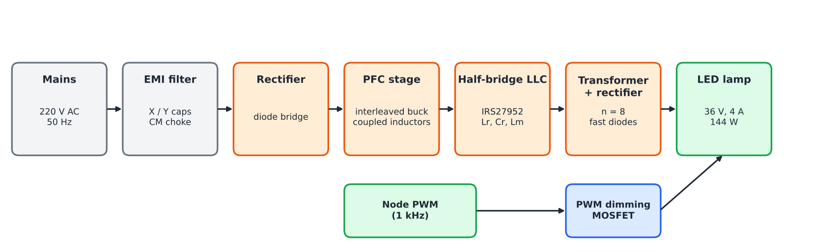
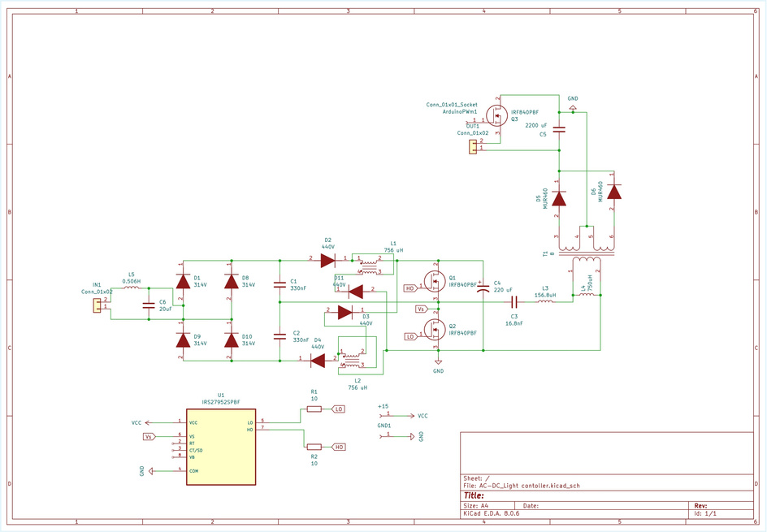

# LED driver — 220 V AC to 36 V / 4 A

## Briefing

The lamp needs a driver that runs on the 220 V / 50 Hz mains and can be dimmed by the node.
We started from a published single-stage driver made for 110 V / 60 Hz, and adapted it to 220 V / 50 Hz.

"Single-stage" means the power factor correction (PFC) and the isolated DC-DC conversion share the same switches.
This needs fewer parts than the usual two-stage driver.

## How it works

1. **EMI filter:** stops the switching noise from going back to the mains.
2. **Rectifier:** a diode bridge turns the AC into a pulsed DC.
3. **PFC stage:** an interleaved buck with coupled inductors, in discontinuous mode. The input current follows the mains voltage by itself, so the power factor is high without a current loop.
4. **Half-bridge LLC:** two MOSFETs switch at 50 % duty cycle. The resonant circuit (Lr, Cr, Lm) gives soft switching and a high efficiency. The output is regulated by changing the switching frequency.
5. **Transformer and rectifier:** isolation from the mains and the 36 V output.
6. **Dimming:** a MOSFET at the output, driven by the node's PWM signal, sets the light level.

## Specifications

| Item | Value |
|---|---|
| Input | 220 V AC, 50 Hz (198 V to 264 V) |
| Output | 36 V, 4 A (144 W) |
| Resonant frequency | 100 kHz |
| Switching frequency | 52.5 kHz to 150 kHz |
| Target efficiency | 90 % |
| Target power factor | > 0.98 |
| Controller | IRS27952 (half-bridge resonant controller and gate driver) |

## Main components

| Part | Value |
|---|---|
| PFC inductors L1, L2 (coupled) | 756 µH |
| Resonant inductor Lr | 150 µH |
| Resonant capacitor Cr | 15 nF |
| Magnetizing inductance Lm | 750 µH |
| Transformer | ETD39 core, ratio 8 (80 / 10 turns) |
| Output diodes | MUR460 (fast recovery) |
| Half-bridge MOSFETs | 600 V N-channel |
| Dimming MOSFET | Logic-level N-channel, driven by the node PWM |
| Output capacitor | 2200 µF |

## Schematic

## Notes

- The MOSFETs of the half-bridge see the full DC bus. At 220 V they need a 600 V rating (the 500 V IRF840 shown in the schematic is too low).
- The node gives a 3.3 V PWM signal. The dimming MOSFET must turn on fully at 3.3 V, or use a small gate driver.
- This is a paper design. Work on mains voltage only with an isolation transformer and the right equipment.

## Reference

C.-A. Cheng et al., "A Single-Stage High Power Factor Power Supply for Providing an LED Street-Light Lamp Featuring Soft-Switching and Bluetooth Wireless Dimming Capability", *Energies*, 2021, 14, 477.
Infineon (International Rectifier), AN-1160, "Design of Resonant Half-Bridge converter using IRS2795(1,2) Control IC".

See the [main README](../README.md).
