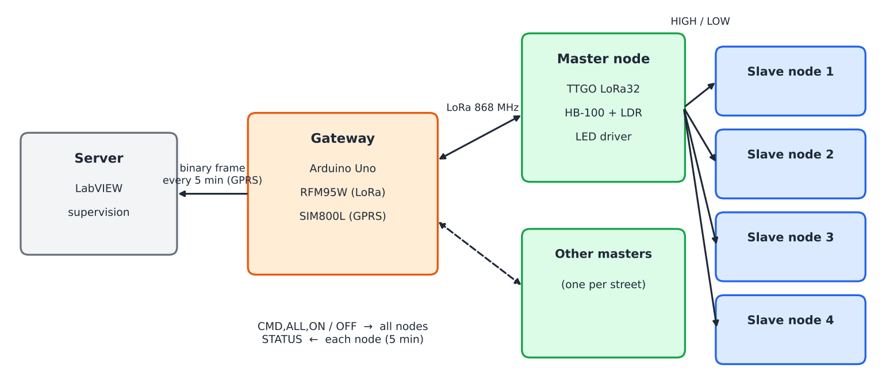
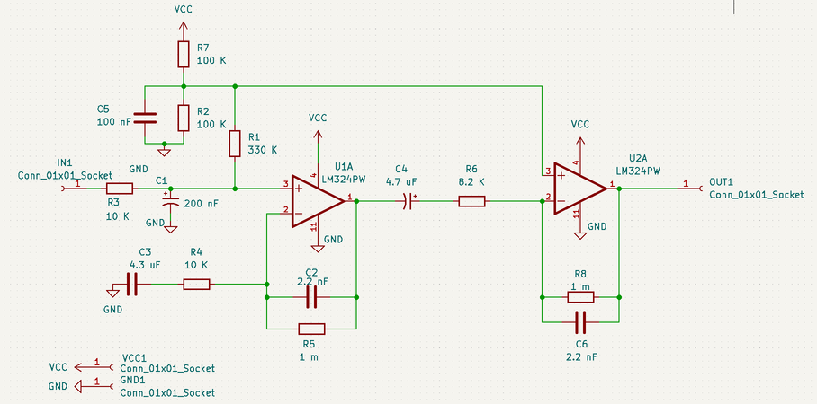
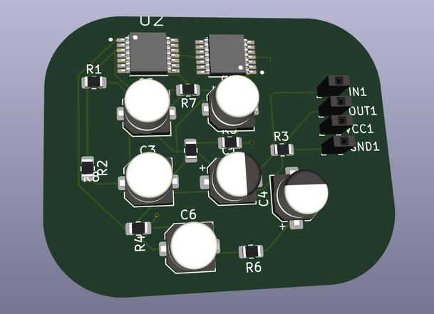
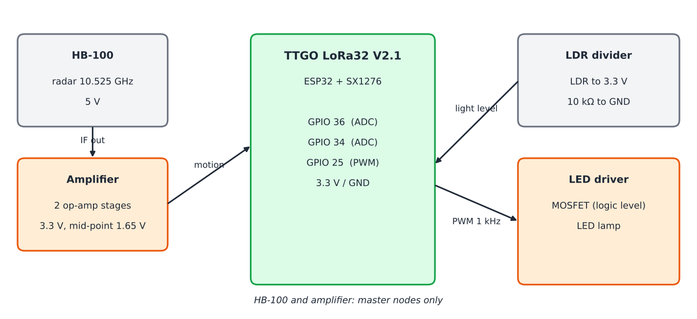
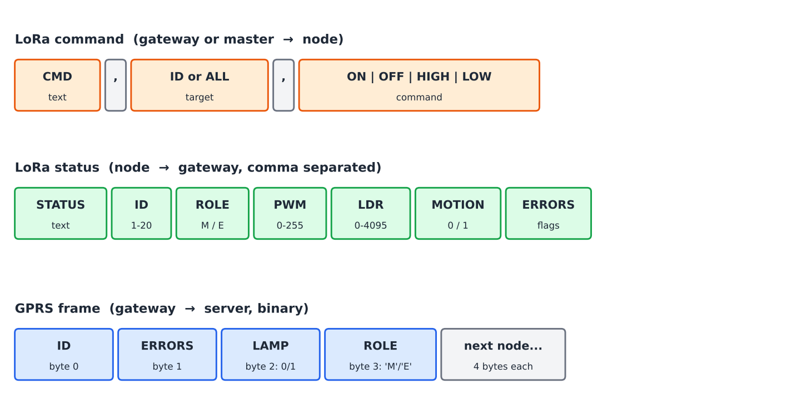

# Smart street lighting with LoRa (ESP32, Arduino)

## Briefing

We want to make street lights smarter and cheaper to run.
Each lamp post gets a small LoRa board. The lamps turn on at sunset, stay at a low level at night, and go to full power when a car or a person passes.

- **Gateway** (one for the area): knows the time, computes sunrise and sunset, and sends ON or OFF to all lamps. It collects the lamp reports and sends them to a server over GPRS.
- **Master node** (one per street): has a radar motion sensor (HB-100). When it sees motion, it turns its lamp and its slaves to full power.
- **Slave nodes**: follow the gateway and their master.

Every node checks its own lamp with a light sensor (LDR) and reports faults.
The same firmware runs on masters and slaves. Only one line changes.

## Folders

| Folder | Content |
|---|---|
| `Node/node/` | `node.ino`: lamp node firmware (master or slave) |
| `Gateway/gateway/` | `gateway.ino`: gateway firmware |
| `docs/figures/` | Figures used in this README |

## Hardware

### Boards and modules

| Part | Role | Used in |
|---|---|---|
| TTGO LoRa32 V2.1 (ESP32 + SX1276) | Node controller and LoRa radio | Every node |
| HB-100 | Doppler radar, 10.525 GHz | Master nodes |
| HB-100 amplifier (2 op-amp stages) | Makes the radar signal readable by the ADC | Master nodes |
| LDR + 10 kΩ | Checks that the lamp gives light | Every node |
| Logic-level MOSFET | Dims the LED lamp with PWM | Every node |
| Arduino Uno | Gateway controller | Gateway |
| RFM95W (SX1276, 868 MHz) | Gateway LoRa radio | Gateway |
| SIM800L + LM2596 | GPRS link to the server, and its 4 V supply | Gateway |

### LoRa settings

| Setting | Value |
|---|---|
| Frequency | 868 MHz |
| Spreading factor | SF9 |
| Bandwidth | 125 kHz |
| Coding rate | 4/5 |
| TX power | 14 dBm |
| Sync word | `0x12` (private network) |
| CRC | on |

Gateway and nodes must use the same settings.

### HB-100 amplifier

The HB-100 output is very small (microvolts). Two op-amp stages amplify it and filter the noise.
The output sits around half the supply when nothing moves, and swings when something moves.

- Power the amplifier from 3.3 V, so the output stays inside the ESP32 ADC range (0 to 3.3 V).
- The code looks at how far the signal moves from its resting level, not at a fixed value.

### LED driver (study)

A single-stage LED driver for the 220 V / 50 Hz mains was also studied: power factor correction followed by an LLC resonant converter.

| Item | Value |
|---|---|
| Input | 220 V AC, 50 Hz |
| Output | 36 V, 4 A (144 W) |
| Topology | Interleaved PFC stage + half-bridge LLC |
| Controller | IRS2795 |

This part is a paper design. It is not needed to run the code.

## Wiring

### Node (TTGO LoRa32 V2.1)

| Signal | TTGO pin | Connected to |
|---|---|---|
| LoRa radio | on board (SCK 5, MISO 19, MOSI 27, CS 18, RST 23, DIO0 26) | nothing to wire |
| PWM | GPIO 25 | MOSFET gate (through 100 Ω) |
| LDR | GPIO 34 | middle of the LDR / 10 kΩ divider |
| HB-100 | GPIO 36 | amplifier output (master only) |
| GND | GND | all grounds together |

- Never put 5 V on an ESP32 pin.
- GPIO 35 is already used by the battery divider on this board.
- GPIO 25 is also the green LED of the board: it shows the lamp level.

### Gateway (Arduino Uno)

| RFM95W | Uno |
|---|---|
| NSS | 10 |
| SCK | 13 |
| MOSI | 11 |
| MISO | 12 |
| RESET | 9 |
| DIO0 | 2 |
| 3.3 V / GND | 3.3 V regulator / GND |

| SIM800L | Uno |
|---|---|
| TXD | 7 |
| RXD | 8 (through a 5 V → 2.8 V divider) |
| VCC | LM2596 set to 4.0 V (not the Uno 5 V) |
| GND | GND |

- The RFM95W is a 3.3 V part: use a level shifter on NSS, SCK, MOSI and RESET.
- The SIM800L needs up to 2 A for short peaks. Add a large capacitor on its supply.
- Connect both antennas before power-on.

## Messages

### LoRa (text)

| Message | Sender → receiver | Meaning |
|---|---|---|
| `CMD,ALL,ON` | gateway → all | Night: lamps on at low level (30 %) |
| `CMD,ALL,OFF` | gateway → all | Day: lamps off |
| `CMD,<id>,ON` / `OFF` | master → its slaves | Same, repeated for slaves out of the gateway's range |
| `CMD,<id>,HIGH` | master → its slaves | Motion: full power |
| `CMD,<id>,LOW` | master → its slaves | No more motion: back to low level |
| `STATUS,<id>,<role>,<pwm>,<ldr>,<motion>,<errors>` | node → gateway | Report every 5 min, or at once when a fault appears |

### GPRS frame (binary)

Every 5 minutes the gateway sends one TCP frame to the server. It has 4 bytes for each node that sent news.

| Byte | Content |
|---|---|
| 0 | Node ID (1 to 20) |
| 1 | Error flags |
| 2 | Lamp state: 1 = on, 0 = off |
| 3 | Role: `'M'` or `'E'` |

### Error flags

| Bit | Value | Fault | Found by |
|---|---|---|---|
| 0 | `0x01` | HB-100 signal stuck | node |
| 1 | `0x02` | LDR disconnected | node |
| 2 | `0x04` | No command from the gateway for 2 h | node |
| 3 | `0x08` | Lamp gives no light | node |
| 7 | `0x80` | Lamp too dark at full power | gateway |

## Code

- **`node.ino`:**
  - Set `NODE_ROLE` (`'M'` or `'E'`) and `NODE_ID` before upload. A master drives the next 4 IDs.
  - The lamp level changes smoothly with PWM.
  - When the lamp turns on, the LDR must see light, or the node reports a lamp fault.
  - Master: motion → full power and `HIGH` to the slaves. 60 s after the last motion → low level and `LOW`.
  - Slave: if the `LOW` message is lost, it goes back to low level by itself.
  - Safe mode: after 2 h without news from the gateway, the lamp stays on at low level.
  - A watchdog restarts the board if the code gets stuck.
- **`gateway.ino`:**
  - Gets the time from the network (GPRS), then computes sunrise and sunset for the site.
  - Sends `CMD,ALL,ON` or `CMD,ALL,OFF` every minute.
  - Stores the node reports and adds the brightness check.
  - Sends the GPRS frame every 5 minutes. Data is kept if the sending fails.

Both programs read LoRa packets in the main loop (no SPI access inside an interrupt).

## How to use

1. Install the Arduino IDE, the ESP32 board package (2.x or 3.x), and the libraries **LoRa** (Sandeep Mistry) and **TinyGSM**.
2. Gateway: open `Gateway/gateway/gateway.ino`. Set the APN, the server address and port, and the site position (`SITE_LAT`, `SITE_LON`). Upload to the Uno.
3. Nodes: open `Node/node/node.ino`. Set `NODE_ROLE` and `NODE_ID`, then upload to each TTGO board. Example: master 1 with slaves 2 to 5, master 6 with slaves 7 to 10.
4. Open the serial monitor at 115200 baud to follow each board.
5. On the server, listen on the TCP port and read the frames by blocks of 4 bytes.

**Result:** at sunset all lamps go to 30 %. When the master sees motion, its street goes to 100 % and comes back to 30 % one minute later. At sunrise all lamps turn off. The server gets the state and the faults of every lamp every 5 minutes.
